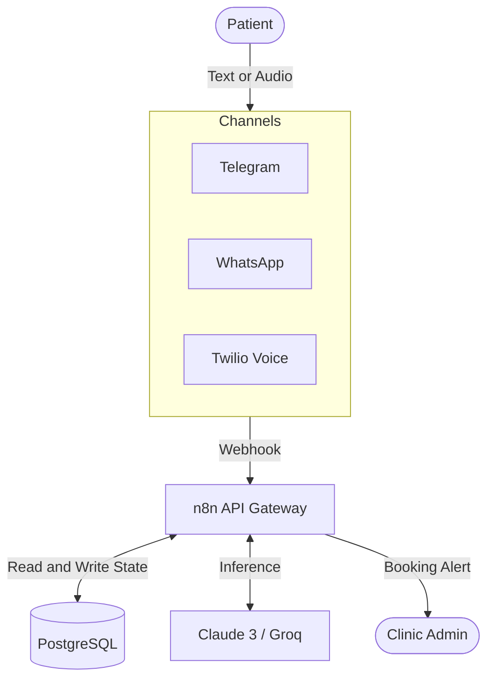

# Omnichannel AI Clinic Receptionist

This is an automated booking and inquiry system for medical clinics built with n8n, PostgreSQL, and LLMs (Claude 3 / Groq). The architecture separates the core AI engine from the communication channels, allowing the system to handle Telegram, WhatsApp, and Twilio voice calls using the same logic and database.

## System architecture



## Core design

The system relies on PostgreSQL constraints rather than AI logic to prevent double bookings. All schedules, doctor profiles, and chat memory remain in the database.

An initialization script automatically injects the required n8n workflows during the first Docker startup. You do not need to manually import JSON files.

## Local setup

You need Docker and Docker Compose installed on your machine.

1. Copy `.env.example` to `.env` and fill in your API keys (Twilio, LLM provider).
2. Start the containers:
   ```bash
   docker-compose up -d
   ```
3. Wait roughly 30 seconds. The n8n container waits for PostgreSQL to initialize, then automatically imports the core engine, Telegram, and WhatsApp workflows.
4. Access the n8n dashboard at http://localhost:5678 using the default credentials specified in your environment file.

You must manually add your API credentials (Anthropic, Telegram Bot token) inside the n8n UI. The n8n platform prevents automated credential injection for security reasons.

## Voice channel setup

The system supports inbound phone calls via Twilio.

Purchase a Twilio number and add your Account SID and Auth Token to the `.env` file. Point the Twilio incoming call webhook to the n8n voice endpoint. The AI will answer the call, process speech, and return a voice response using TwiML.

## Modifying clinic data

The default database uses mock data for an aesthetic and dental clinic. 

To use real client data, edit `init-db/02-schema_and_seed.sql` before starting the containers. If you have already started the database, you must destroy the volume (`docker-compose down -v`) and restart to apply the new seed data.
